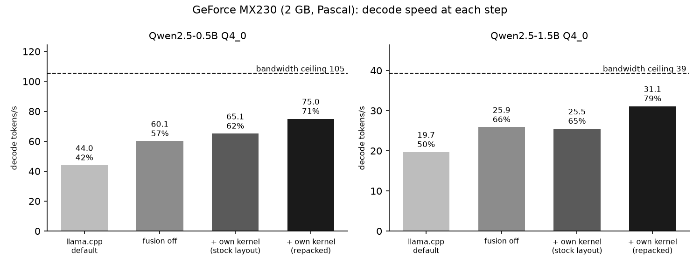

# mx230-llm-roofline

**Making small LLMs run fast on a 2 GB laptop GPU that the CUDA world has left behind.**

The GPU is a **GeForce MX230**: Pascal (sm_61), 2 SMs, 2 GB GDDR5 on a 64-bit bus, no tensor cores.
CUDA 13 dropped Pascal, PyTorch 2.15 drops it, vLLM needs sm_70+, and FlashAttention has no Pascal path.
So this project uses llama.cpp built with CUDA 12.9, measures everything against a bandwidth ceiling,
and then writes its own CUDA kernels.

Project page: https://dheepakkaran.github.io/mx230-llm-roofline/

<a href="https://dheepakkaran.github.io/mx230-llm-roofline/#overview"></a>

<sub>128-second keynote film (2:08; silent preview at 4x speed). <a href="https://dheepakkaran.github.io/mx230-llm-roofline/#overview">Watch it with sound on the project page →</a> · <a href="https://dheepakkaran.github.io/mx230-llm-roofline/media/overview.mp4">35-second short version</a></sub>

> **Found along the way:** llama.cpp's CUDA kernel fusion makes token generation 20–36% *slower* on this
> Pascal GPU, with identical output when it is switched off. Reported upstream as
> [ggml-org/llama.cpp#32229](https://github.com/ggml-org/llama.cpp/issues/32229).
> Root cause (a version check that missed cc 6.1) fixed in a one-line PR,
> **merged 2026-11-17**: [ggml-org/llama.cpp#32239](https://github.com/ggml-org/llama.cpp/pull/32239)
> ([113-second story film](https://dheepakkaran.github.io/mx230-llm-roofline/#upstream-film)).



## Results

| | Qwen2.5-0.5B Q4_0 | Qwen2.5-1.5B Q4_0 |
|---|---|---|
| llama.cpp default | 44.0 tok/s (42% of ceiling) | 19.7 tok/s (50%) |
| `GGML_CUDA_DISABLE_FUSION=1` | 60.1 (57%) | 25.9 (66%) |
| + own Q4_0 kernel, repacked layout | **75.0 (71%)** | **31.1 (79%)** |
| total | **1.70×** | **1.58×** |
| perplexity (wikitext-2, batch 1) | 23.14 → 23.10 | 14.44 → 14.41 |

1. **Ceiling first.** Decode reads every weight once per token, so
   `max tok/s = memory bandwidth ÷ bytes read per token`. A read kernel (`kernels/bw.cu`) measures
   **36.5 GB/s** (65% of the 56 GB/s spec). Bytes per token come from the GGUF tensors
   (`scripts/bytes_per_token.py`).
2. **Baseline + 7 built-in tricks** (flash attention, INT8 KV cache, batch size, CPU/GPU layer split,
   speculative decoding with a 0.5B draft, n-gram drafting, prefix cache). Highlights: flash attention
   1.7× at a 4K context; a prefix cache cuts a long-system-prompt answer from 5.9 s to 0.9 s; a 3B model
   fits in 2 GB at a 4K context only with INT8 KV *and* a smaller batch; speculative decoding loses up
   to 29% because the draft costs ~45% of the target on a shared 36.5 GB/s bus.
3. **Profiling with nvprof** (Nsight Compute does not support Pascal). Forcing CUDA graphs on changed
   nothing (launch overhead is not the problem). The **fused FFN gate+up matvec** took half of each
   token at 28% of bandwidth; with fusion off decode is **20–36% faster with identical output**.
   Reported upstream: [ggml-org/llama.cpp#32229](https://github.com/ggml-org/llama.cpp/issues/32229); fixed by [#32239](https://github.com/ggml-org/llama.cpp/pull/32239), merged 2026-11-17.
4. **Own Q4_0 matvec kernels** (`kernels/q4mv.cu`, seven versions, each checked against a CPU
   reference). DP4A integer math plus a **repacked, 16-byte-aligned weight layout** reaches **84–94% of
   the ceiling** on large matrices, 1.3–1.6× faster per call than llama.cpp. Same math on the stock
   18-byte layout tops out at 27–61%: the layout is the biggest lever.
5. **Inside llama.cpp** (`patches/02-mx-q4-pascal-matvec.patch`, opt-in `GGML_CUDA_MX_Q4=repack`):
   the measured end-to-end speed matches the per-kernel projection (75.0 vs ~75 tok/s), and perplexity
   is unchanged.

Every number, its method, and its caveats are in [`results/RESULTS.md`](results/RESULTS.md).

## Limits

- One GPU, one laptop, two model sizes; results are for decode with batch size 1.
- The repacked mode keeps a second copy of the Q4_0 weights in VRAM (~0.89× of their size).
- The tiny 128-row K/V matvec is slower in my kernel than in llama.cpp (6.1 vs 5.0 µs).
- The root cause of the fusion slowdown is not proven: `nvprof --metrics` fails on driver 580 even
  as root, so occupancy and stall counters could not be read. Fused uses 80 registers/thread vs 66.
- The llama.cpp patch is a research hook (one-column, unfused, non-MoE Q4_0 only), not a PR.

## Reproduce

```bash
pixi install                                   # CUDA 12.9 toolchain (last one that targets sm_61)
pixi run nvcc -O3 -arch=sm_61 kernels/bw.cu -o build/bw && ./build/bw 512
pixi run nvcc -O3 -std=c++17 -arch=sm_61 kernels/q4mv.cu -o build/q4mv && ./build/q4mv 200

git clone https://github.com/ggml-org/llama.cpp third_party/llama.cpp
git -C third_party/llama.cpp checkout b79696f
git -C third_party/llama.cpp apply ../../patches/01-cuda-graphs-pre-volta.patch ../../patches/02-mx-q4-pascal-matvec.patch
pixi run cmake -S third_party/llama.cpp -B build/llama -G Ninja -DGGML_CUDA=ON -DCMAKE_CUDA_ARCHITECTURES=61 -DCMAKE_BUILD_TYPE=Release
pixi run cmake --build build/llama --target llama-bench llama-perplexity

GGML_CUDA_DISABLE_FUSION=1 GGML_CUDA_MX_Q4=repack \
  build/llama/bin/llama-bench -m qwen2.5-0.5b-instruct-q4_0.gguf -ngl 99 -fa on -p 0 -n 128
```

Models: official `Qwen/Qwen2.5-{0.5B,1.5B,3B}-Instruct-GGUF` files. The GPU reaches 80–90 °C in long
runs; the scripts wait for it to cool between runs.

## Layout

| path | what |
|---|---|
| `kernels/bw.cu` | bandwidth probe |
| `kernels/q4mv.cu` | seven Q4_0 matvec kernels + benchmark |
| `patches/` | llama.cpp patches (CUDA graphs opt-in + counter; Pascal Q4_0 matvec hook) |
| `scripts/` | baseline, roofline, nvprof summary, kernel table, figures |
| `results/RESULTS.md` | all results |
| `docs/` | project page |
